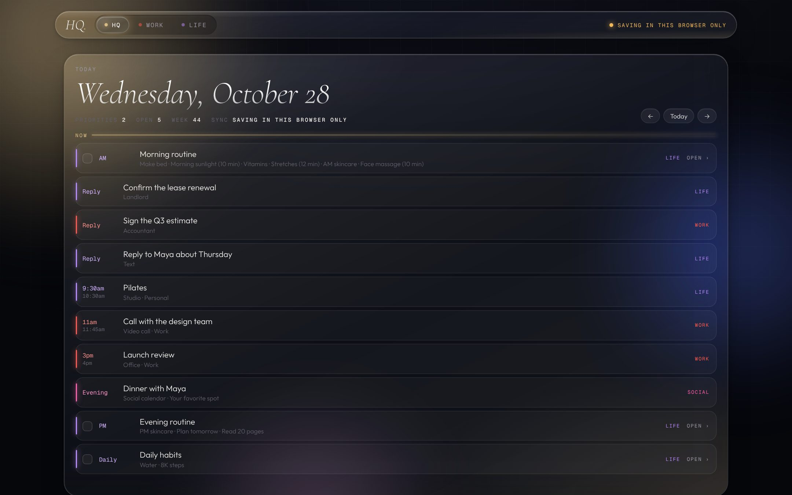
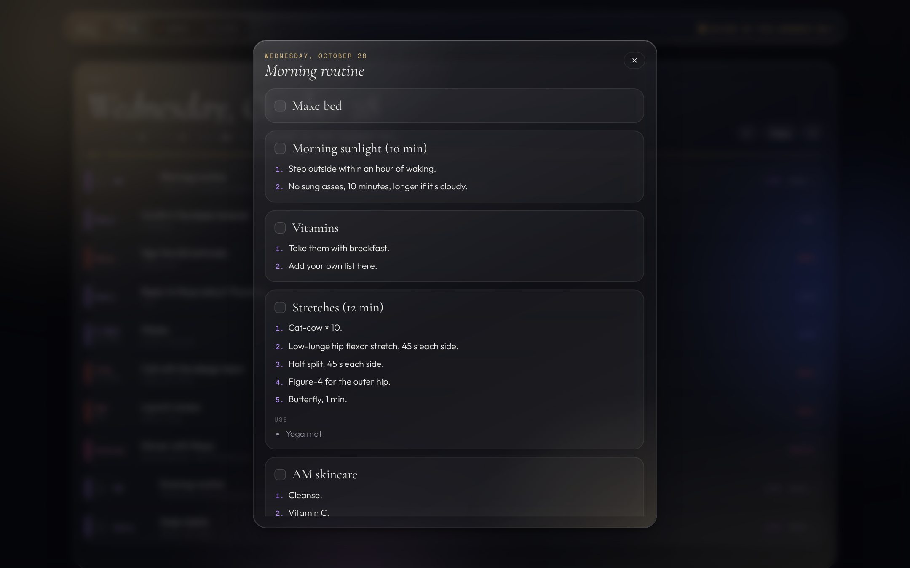
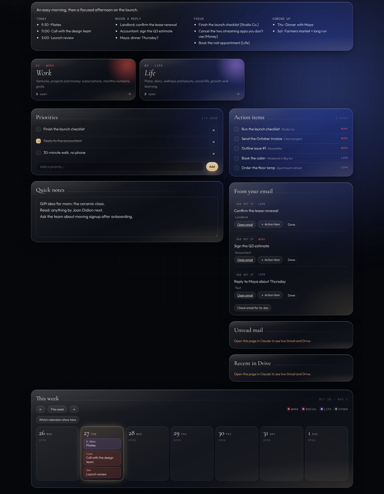
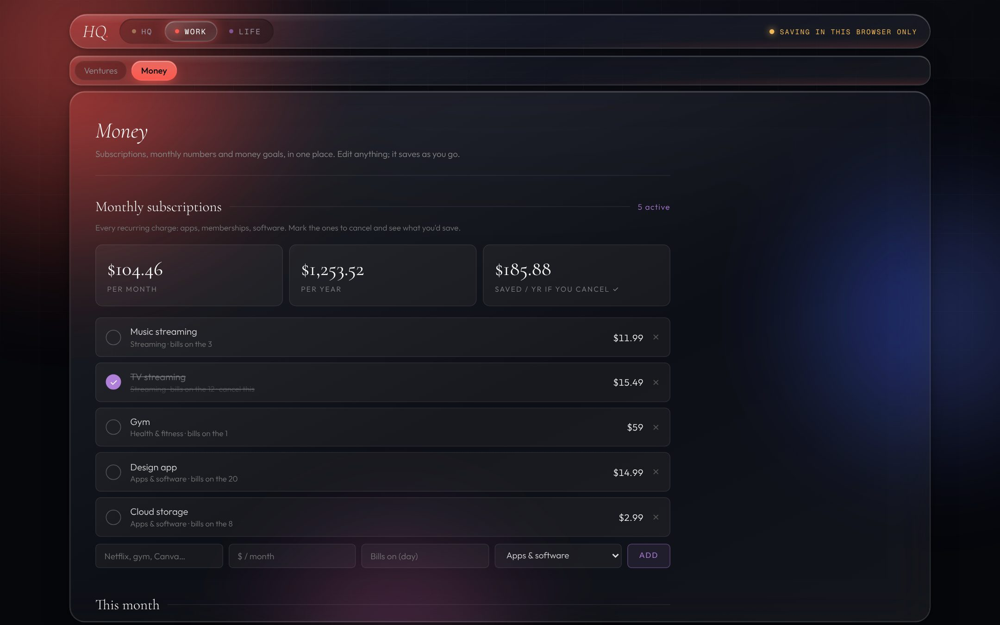

# HQ: a personal operating system

Part of [Pretty Technical](https://prettytechnicalclub.com). One page that opens on your whole day, plus a Work area and a Life area behind it. This is the structure I use for my own life, with my data taken out, so you can fill it with yours.

**[Live demo](https://prettytechnicalclub.github.io/hq/?demo)** (sample data) · Related: [Wellness Dashboard](https://github.com/prettytechnicalclub/wellness-dashboard) · [TikTok to Dashboard](https://github.com/prettytechnicalclub/tiktok-to-dashboard)



## The structure

```
HQ (home)
├── Today: morning routine (one tap, or open it to tick each step)
│          → replies due → calendar events → evening routine
├── Morning brief (written for you at 6:45 by a Claude scheduled task)
├── Priorities (today's top 3) + Quick notes
├── Action items (every open to-do from Work and Life)
├── From your email (to-dos Claude pulls from your inbox)
└── This week (7-day calendar)

Work
├── Ventures: a card per company, client or project, each with its own to-dos
└── Money: monthly subscriptions + yearly total, monthly targets, money goals

Life
├── Personal: Plans · Diary · Notes · Vision Board · Prayer · Books & Media
├── Wellness: Routines & Beauty (routines with how-tos, beauty calendar, tracker)
├── Social: Social Life (events show on your Today timeline)
└── Growth: Growth & Learning (learning now, skills, goals, reflections)
```





## Use it

**In Claude (recommended).** Download `index.html`, upload it to Claude and say: *"Publish this as an artifact with the database and user capabilities, and connect Google Calendar and Gmail."* Your data syncs across devices, the calendar is live and the email to-dos work.

**On its own.** Open `index.html` in any browser (or fork this repo and turn on GitHub Pages). Everything saves in that browser. Calendar and email need Claude.

**The morning brief.** In Claude, create a daily scheduled task with `prompts/morning-brief.md`.

## Make it yours

This isn't meant to fit you as-is. Take the structure and keep only what you'd use.

- **Your name and details:** edit `window.CONFIG` near the top of `index.html`.
- **Remove a page:** search for `const HUBS` and delete its line, e.g. `['prayer','Prayer','prayer'],`.
- **Rename a page:** change the middle word in that line, e.g. `'Ventures'` → `'Clients'`.
- **Routines:** add, edit and reorder them in the app (Life → Routines & Beauty → Daily routine). Give each step a how-to: a video link, steps and products.
- **Let Claude do it:** upload `index.html` with `prompts/customize.md`, or start from nothing with `prompts/build-your-own-hq.md`.

Nothing here is financial or medical advice. MIT licensed.
